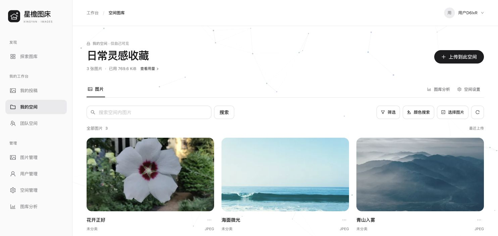
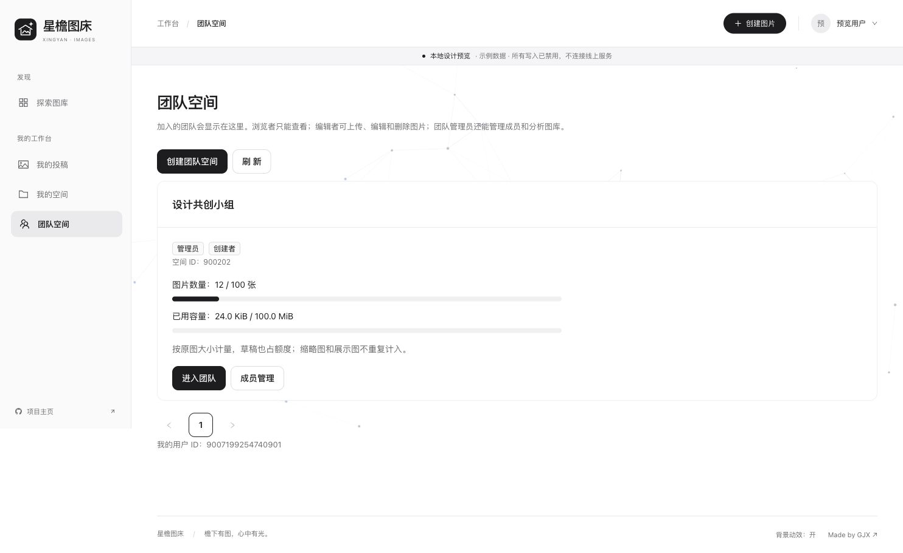
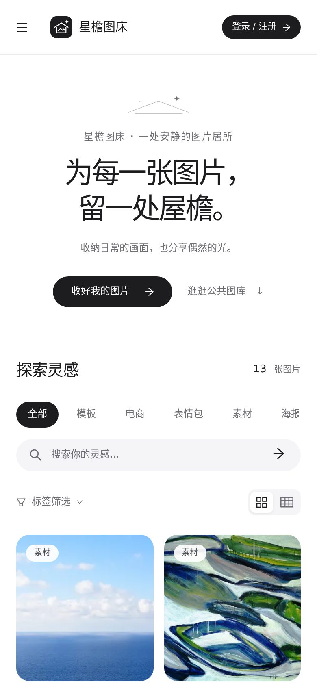
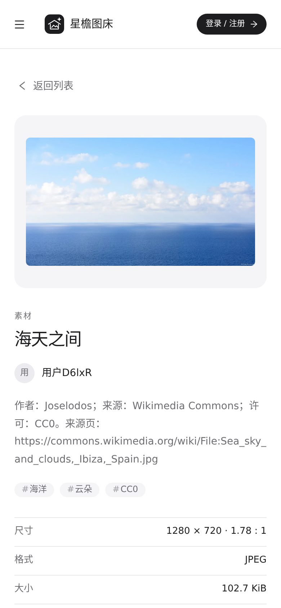
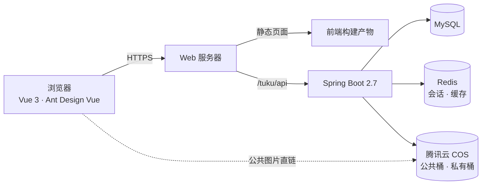

<p align="center">
  
</p>

<h1 align="center">星檐图床</h1>

<p align="center">
  <b>为每一张图片，留一处屋檐。</b><br />
  <sub>公共图库 · 个人图床 · 团队图床 —— 一个安静、好找、也方便分享的图片居所。</sub>
</p>

<p align="center">
  <a href="https://tc.higjx.com/"></a>
  
  
  
  
  
</p>

<p align="center">
  <a href="https://tc.higjx.com/"><b>打开星檐 →</b></a>
  &nbsp;·&nbsp;
  <a href="#三种图床">三种图床</a>
  &nbsp;·&nbsp;
  <a href="#本地运行">本地运行</a>
  &nbsp;·&nbsp;
  <a href="docs/getting-started.md">部署指南</a>
</p>

<a href="https://tc.higjx.com/"></a>

<p align="center"><sub>本文截图均直接拍摄于 <a href="https://tc.higjx.com/">tc.higjx.com</a>（2026 年 10 月 30 日），是当时真实的线上界面与内容，之后可能随更新变化。</sub></p>

照片、截图、随手存下的灵感，攒着攒着就散在了不同的文件夹里。星檐想给这些画面一个好找、好整理，也方便分享的地方。

界面尽量安静一点：黑白、留白，把颜色留给图片本身。第一次来，可以先在公共图库随便逛逛，不用登录；想分享作品或整理自己的图片时，再注册就好。

## 三种图床

|  | 公共图床 | 个人图床 | 团队图床 |
| --- | --- | --- | --- |
| **谁能看到** | 所有访客 | 只有你自己 | 团队成员 |
| **适合做什么** | 分享作品，逛逛别人的好图 | 收好参考图、日常照片与私藏素材 | 和伙伴共用一份项目素材 |
| **在哪里** | 首页「探索图库」·「我的投稿」 | 「我的空间」 | 「团队空间」 |
| **亮点** | 分类、标签、关键词找图；投稿审核 | 容量统计、按颜色找图、批量操作 | 浏览 / 编辑 / 管理三种角色，协同编辑 |

### 公共图库：先逛逛，找点灵感

按分类、标签和关键词找图，也可以切换疏密布局。从海景到画作，不登录也能先看看这里都收了些什么。


### 图片详情：喜欢一张图，就点进去看看

大图放在安静的浅灰画布上，右边是标题、作者、简介和标签，尺寸、格式、大小与主色调收在一张简洁的信息表里，分享入口也在这里。


<sub>图中的「海天之间」来自线上公共图库，简介里保留了作者、来源与许可说明。</sub>

### 我的投稿：分享出去的作品，都在这里

已公开、待审核、草稿、需修改，一眼就能分清。需要修改的作品会显示审核反馈，完善后可以重新提交；草稿和未通过审核的作品不会出现在公共图库。

### 个人图床：留给自己的图片，收进「我的空间」

收集参考图、整理日常照片，或者留一份自己的创作素材。空间把图片、搜索和容量用量放在一起，想找图时不用只靠记住文件名。



<sub>截图是线上账号尚未创建个人空间时的实际页面。</sub>

### 团队图床：一起用的素材，交给「团队空间」

团队成员在同一个空间里查看和整理图片。浏览者只能查看，编辑者可以上传、编辑和删除，团队管理员还能管理成员、分析图库；基于 WebSocket 的协同编辑会同步大家的修改状态。



<sub>截图是线上账号尚未加入团队时的实际页面。</sub>

> 个人与团队空间里的图片存放在独立的私有存储桶中，匿名访问会被拒绝。部署自己的实例时，需要按[启动指南](docs/getting-started.md)单独配置私有存储。

## 在手机上，也一样好用

<p align="center">
  
  &nbsp;&nbsp;
  
</p>

## 用起来才会注意到的小地方

- 从图片详情返回列表，会回到之前的筛选条件和浏览位置。
- 编辑内容还没保存就离开页面，会先提醒一下。
- 可以在设置里修改昵称、简介和密码；改密码后，其他设备上的登录会自动失效。
- 连续输错密码会被暂时限制登录，账号也不会因为提示文字暴露是否存在。
- 背景粒子和动态效果都可以关掉，也会遵循系统的「减少动态效果」设置。
- 图片处理包含上传、裁剪、缩略图与展示图；图库分析提供容量、分类、标签、大小与上传趋势等视角。

## 本地运行

### 先看看界面

仓库自带一个用合成数据的预览模式，不需要数据库或云密钥。准备 Node.js `^20.19.0` 或 `>=22.12.0`，然后执行：

```sh
git clone https://github.com/hollegjx/xingyan-image-host.git
cd xingyan-image-host/frontend
npm ci
npm run dev:design
```

打开 **[http://localhost:5173/](http://localhost:5173/)** 就能看到界面。预览模式里所有写入都被禁用，不会执行真实的登录、上传、删除或 AI 请求，部分依赖后端的页面也没有预览数据；它适合看界面，不能用来打包生产版本。

### 再把完整服务跑起来

真实使用需要分别启动前端和后端，并配置 MySQL、Redis；图片存储与可选的外部服务按需接入：

| 你现在想做什么 | 从这里开始 |
| --- | --- |
| 初始化数据库、配置环境、完整启动 | [启动与部署指南](docs/getting-started.md) |
| 修改页面、运行前端测试和构建 | [前端开发说明](frontend/README.md) |
| 调整接口、运行后端测试 | [后端开发说明](backend/README.md) |
| 准备自己的线上部署 | [配置安全与发布检查](SECURITY.md) |

## 实现概览

星檐采用前后端分离的结构，前后端放在同一个仓库里，方便一起阅读和联调。



| 部分 | 使用的技术 | 在项目里负责什么 |
| --- | --- | --- |
| 页面与交互 | Vue 3、TypeScript、Vite、Pinia、Ant Design Vue | 图库、工作台、表单与界面状态 |
| 接口与数据 | Java、Spring Boot 2.7、MyBatis-Plus、MySQL | 图片和空间业务、权限校验、数据存储 |
| 缓存与登录 | Caffeine、Redis、Spring Session | 公共图片分页缓存、会话管理与登录失败限制 |
| 图片与协作 | 腾讯云 COS、WebSocket、Disruptor | 图片存储与处理、协作编辑事件 |
| 数据展示 | ECharts | 图库容量、内容分布与上传趋势 |
| 验证 | Vitest、Playwright、JUnit、H2 | 前后端测试与交互回归，另有隔离 Redis 测试 |

```text
xingyan-image-host/
├── frontend/             # 页面、组件、接口调用与前端测试
├── backend/              # Java 服务、SQL 与后端测试
├── docs/                 # 启动说明与界面截图
└── scripts/              # 仓库检查脚本
```

## 还在慢慢完善

如果你试用时遇到了不顺手的地方，或者希望增加某个功能，欢迎在 [Issues](https://github.com/hollegjx/xingyan-image-host/issues) 里聊聊。告诉我们你当时想做什么、卡在哪一步；能附上一张去掉个人信息的截图，就更容易一起找到原因。

AI 扩图与以图搜图是可选能力，线上目前没有开放，自己部署时需要配置对应的服务与凭据；绑定邮箱和注销账户也还没有开放。自动化测试通过，并不等于这些外部服务已经接通。

<details>
<summary>关于源码、第三方资源与部署</summary>

本仓库从源码快照建立独立历史，不包含原开发仓库的真实环境配置、数据库备份或内部记录。目前尚未添加项目级 `LICENSE`；第三方组件信息见[前端说明](frontend/THIRD_PARTY_NOTICES.md)与[后端说明](backend/THIRD_PARTY_NOTICES.md)。

正式部署前，请按[发布检查](SECURITY.md)核对凭据、权限、TLS、Cookie、依赖与备份。示例配置用于帮助启动，不是生产环境的完整配置模板。

</details>

---

<p align="center"><sub>由 <a href="https://github.com/hollegjx">GJX</a> 持续打磨。谢谢你来逛逛，也希望这里能留住一两张你喜欢的画面。</sub></p>
