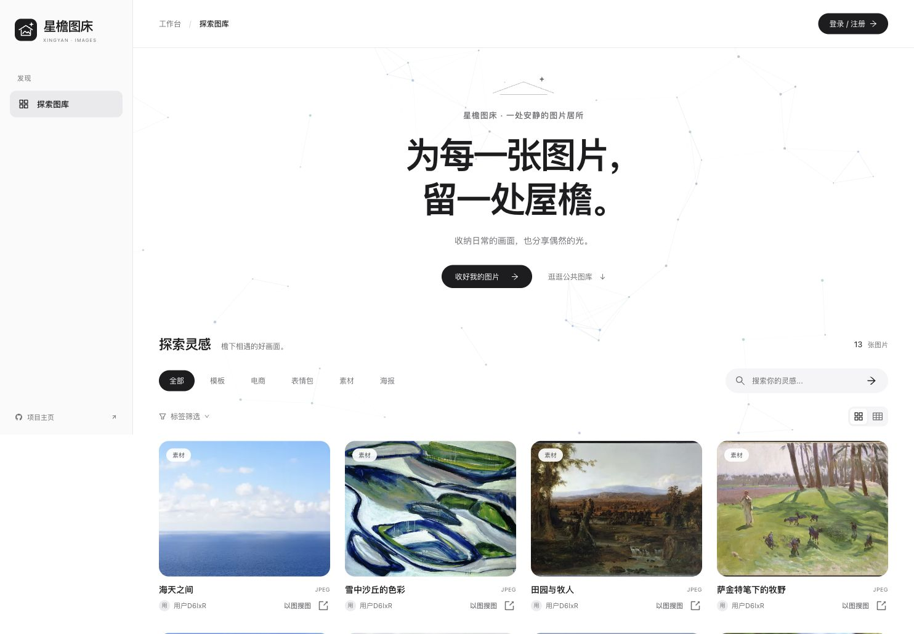
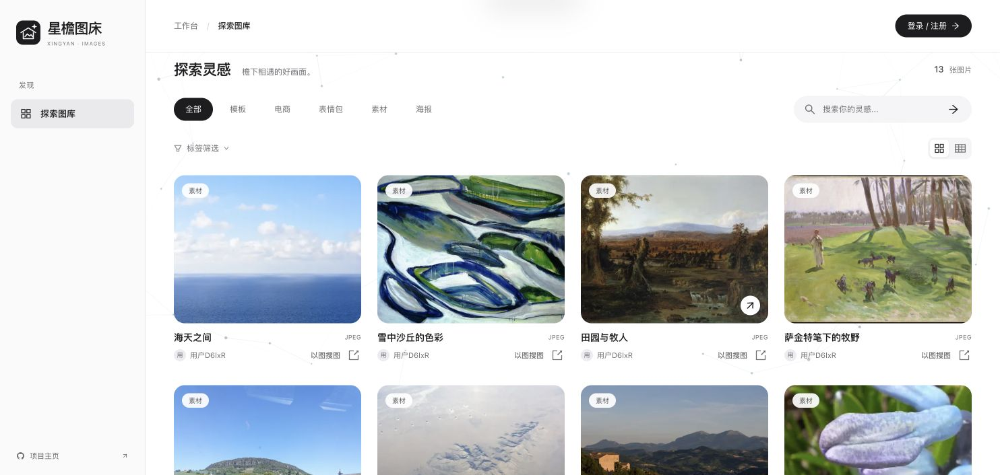
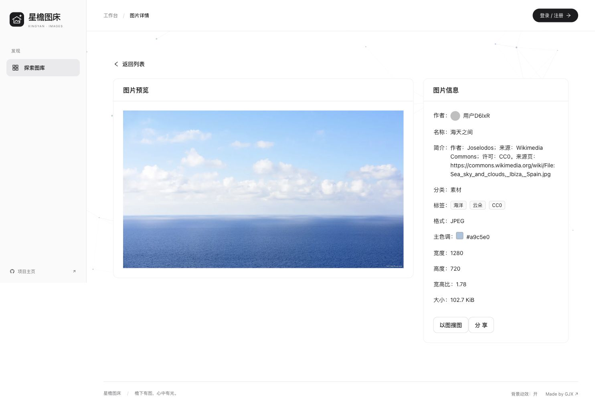

<p align="center">
  
</p>

<h1 align="center">星檐图床</h1>
<p align="center">为每一张图片，留一处屋檐。</p>

<p align="center">
  <strong><a href="https://tc.higjx.com/">打开星檐 · 在线体验</a></strong>
  &nbsp; / &nbsp;
  <a href="#跟着界面逛一圈">界面与功能</a>
  &nbsp; / &nbsp;
  <a href="#在自己的电脑上试试">本地运行</a>
  &nbsp; / &nbsp;
  <a href="docs/getting-started.md">部署指南</a>
</p>

<p align="center">网站地址：<a href="https://tc.higjx.com/">https://tc.higjx.com/</a></p>

照片、截图、随手存下的灵感，攒着攒着就散在了不同的文件夹里。星檐想给这些画面一个好找、好整理，也方便分享的地方。

你可以来公共图库随便逛逛，分享自己的作品，也可以在个人或团队空间里整理图片。界面尽量安静一点：黑白、留白，把颜色留给图片本身。



<p align="center"><sub>截图直接拍摄于 https://tc.higjx.com/，拍摄日期为 2026 年 10 月 28 日。展示的是当时的线上界面与内容，后续可能随更新变化。</sub></p>

## 先来逛逛

**在线体验 → [https://tc.higjx.com/](https://tc.higjx.com/)**

第一次来，可以先浏览公共图库，按分类或关键词找一张感兴趣的图片，再点进去看看详情。想分享作品或使用自己的工作台时，再注册、登录就好。

如果你是来看代码的，可以继续往下看；如果只是想找点灵感，直接打开网站也欢迎。

## 跟着界面逛一圈

### 想找点灵感，先逛逛公共图库

首页可以按分类、标签和关键词找图，也可以切换图片布局。从海景到画作，不用登录也能先看看这里都收了些什么。



### 喜欢一张图，就点进去看看

详情页把图片和信息放在一起：预览、简介、分类、标签、尺寸、格式与主色调，不用来回切换就能了解这张图。



图中的「海天之间」来自线上公共图库，简介保留了作者、来源和许可说明。分享入口也在详情页里，方便把喜欢的图片发给别人。

### 想分享的作品，放进「我的投稿」

发过哪些图片，哪些还在草稿里，哪些正在等审核，都能在这里找到。需要修改的作品会显示反馈，完善后可以重新提交，不用在一堆图片里反复翻找。

**你能在这里做的事：** 查看已公开、待审核、草稿和需修改的作品，按名称搜索，继续编辑或进入详情。草稿与未通过审核的作品不会出现在公共图库。

### 留给自己的图片，收进「我的空间」

收集参考图、整理日常照片，或者留一份自己的创作素材。空间把图片、搜索和容量用量放在一起，想找图时不用只靠记住文件名。

**你能在这里做的事：** 管理空间内图片，按关键词、条件或颜色查找，查看容量与图片数量，并在具备权限时使用批量操作和图库分析。

### 一起用的素材，交给「团队空间」

一起做项目时，团队成员可以在同一个空间里查看和整理图片。浏览、编辑和管理分别对应不同角色，成员管理与用量信息也有单独入口。

**你能在这里做的事：** 进入加入的团队；按角色查看、上传或编辑图片；由团队管理员管理成员与分析图库。项目还实现了基于 WebSocket 的协作编辑状态同步。

> 个人／团队空间的私有图片读写需要配置存储与访问权限。仓库示例配置默认关闭私有图片能力；部署自己的实例时，需要按启动指南接入这些服务。

### 还有一些用起来才会注意到的小地方

- 从图片详情返回列表，会恢复之前的筛选和浏览位置。
- 编辑内容尚未保存时，离开页面会有提醒。
- 图库可以切换疏密布局，背景动效也可以关闭。
- 图片处理包含上传、裁剪、缩略图与展示图；图库分析提供容量、分类、标签、大小与上传趋势等视角。
- AI 扩图、以图搜图是可选能力，需要额外配置服务与凭据，详见[启动说明](docs/getting-started.md)。

## 在自己的电脑上试试

### 先看看界面

想先把页面跑起来，可以用仓库自带的预览模式。准备 Node.js `^20.19.0` 或 `>=22.12.0`，然后执行：

```sh
git clone https://github.com/hollegjx/xingyan-image-host.git
cd xingyan-image-host/frontend
npm ci
npm run dev:design
```

打开 **[http://localhost:5173/](http://localhost:5173/)**，就能用合成数据预览界面，不需要先配置数据库或云密钥。这里的预览数据与上面的线上截图不同。克隆需要具备仓库访问权限。

预览模式使用合成数据，所有写入都被禁用，不执行真实登录、上传、删除或 AI 请求；部分依赖后端的页面不提供预览数据。它适合看界面，完整功能需要连接后端，也不能用这个模式打包生产版本。

### 再把完整服务跑起来

真实使用需要分别启动前端和后端，并配置 MySQL、Redis；图片存储与可选外部服务按需接入。把准备步骤和配置细节放在单独的文档里，方便边做边查：

| 你现在想做什么 | 从这里开始 |
| --- | --- |
| 初始化数据库、配置环境、完整启动 | [启动与部署指南](docs/getting-started.md) |
| 修改页面、运行前端测试和构建 | [前端开发说明](frontend/README.md) |
| 调整接口、运行后端测试 | [后端开发说明](backend/README.md) |
| 准备自己的线上部署 | [配置安全与发布检查](SECURITY.md) |

## 如果你也对实现感兴趣

星檐采用前后端分离的结构。前端负责页面和交互，后端处理图片、空间、权限与数据；两者放在同一个仓库里，方便一起阅读和联调。

| 部分 | 使用的技术 | 在项目里负责什么 |
| --- | --- | --- |
| 页面与交互 | Vue 3、TypeScript、Vite、Pinia、Ant Design Vue | 图库、工作台、表单与界面状态 |
| 接口与数据 | Java、Spring Boot 2.7、MyBatis-Plus、MySQL | 图片和空间业务、权限校验、数据存储 |
| 缓存与登录 | Caffeine、Redis、Spring Session | 公共图片分页缓存与会话管理 |
| 图片与协作 | 腾讯云 COS、WebSocket、Disruptor | 图片存储与处理、协作编辑事件 |
| 数据展示 | ECharts | 图库容量、内容分布与上传趋势 |
| 验证 | Vitest、Playwright、JUnit、H2 | 前后端测试与交互回归，另有隔离 Redis 测试 |

```text
xingyan-image-host/
├── frontend/             # 页面、组件、接口调用与前端测试
├── backend/              # Java 服务、SQL 与后端测试
├── docs/                 # 启动说明与界面截图
└── scripts/              # 仓库检查脚本
```

## 还在慢慢完善

如果你试用时遇到了不顺手的地方，或者希望增加某个功能，欢迎在 [Issues](https://github.com/hollegjx/xingyan-image-host/issues) 里聊聊。告诉我们你当时想做什么、卡在哪一步；能附上一张去掉个人信息的截图，就更容易一起找到原因。

目前普通用户的资料页以展示为主，还没有自助修改资料和密码的接口。真实 COS、AI 与外部搜索也需要自己的服务配置，自动化测试通过并不等于这些服务已经接通。

<details>
<summary>关于源码、第三方资源与部署</summary>

本仓库从源码快照建立独立历史，不包含原开发仓库的真实环境配置、数据库备份或内部记录。目前尚未添加项目级 `LICENSE`；第三方组件信息见[前端说明](frontend/THIRD_PARTY_NOTICES.md)与[后端说明](backend/THIRD_PARTY_NOTICES.md)。

正式部署前，请按[发布检查](SECURITY.md)核对凭据、权限、TLS、Cookie、依赖与备份。示例配置用于帮助启动，不是生产环境的完整配置模板。

</details>

---

由 [GJX](https://github.com/hollegjx) 持续打磨。谢谢你来逛逛，也希望这里能留住一两张你喜欢的画面。
